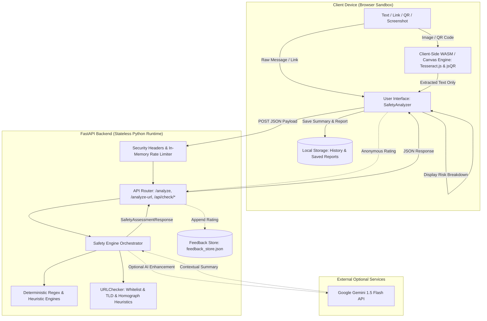
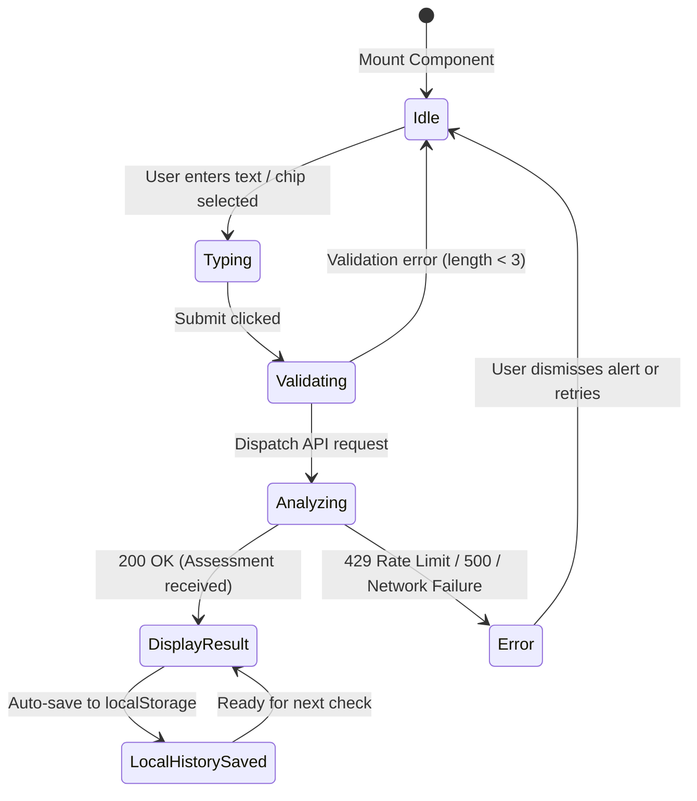

# Data Flow Architecture

**Document Status:** Current as of V6.0 Release (October 2026)  
**Project:** Digital Payment Safety Assistant (ClearPay)  
**Classification:** Verified Data Pathways, Component Lifecycles, and Privacy Boundaries

---

## 1. High-Level Data Flow Topology

Data in the Digital Payment Safety Assistant moves through five distinct, strictly bounded pathways. The overarching architectural principle is **stateless client-server exchange with on-device vision processing**:



---

## 2. Pipeline Deep Dives

### 2.1 Pipeline 1: Text Message Analysis Pipeline

This is the primary pipeline executed when a user pastes a message or enters a payment scenario.

1. **Origin & User Input:**
   - User inputs text into the textarea in `frontend/src/components/SafetyAnalyzer.jsx` (or selects a pre-configured chip like `"Account blocked"` or `"Unexpected UPI request"`).
2. **Client-Side Validation & Preprocessing:**
   - Character counter monitors string length (`0 / 2,000`).
   - If length is `< 3` characters, client displays an inline warning and disables submission.
   - Clears existing error states.
3. **Transport & Network Dispatch:**
   - `apiClient.analyzeMessage()` in `frontend/src/services/apiClient.js` issues an HTTP `POST` request to `/analyze` (or fallback `/api/analyze` / `/api/check/text`) with an `AbortController` timeout of `8,000ms`.
   - Payload:
     ```json
     {
       "text": "Dear customer, your bank account will be blocked today...",
       "use_ai": false,
       "language": "en"
     }
     ```
4. **Gateway & Middleware Interception:**
   - `SecurityHeadersMiddleware` appends `nosniff`, `DENY`, and `strict-origin-when-cross-origin`.
   - `RateLimitingMiddleware` checks client IP against in-memory bucket. If requests in the last 60 seconds exceed `120`, aborts with HTTP `429 Too Many Requests`.
   - `main.py` validates request via Pydantic model `TextCheckRequest` (`min_length=3`, `max_length=2500`).
5. **Backend Processing & Transformation:**
   - `SafetyEngine.analyze_text()` invokes `detect_indicators_in_text()` (`backend/safety/detector.py`).
   - Regex matches categorize red flags (impersonation, urgency, credential solicitation, remote access apps, fake rewards).
   - `extract_urls_from_text()` scans message for embedded HTTP/HTTPS links, strips trailing punctuation, and evaluates each link via `URLChecker.analyze_url()`.
   - `calculate_risk()` computes composite score (0-100) and severity tier (`LOW`, `MEDIUM`, `HIGH`).
   - `generate_recommendations()` creates immediate actionable advice and attaches an `EducationalConcept`.
   - If `language` is `"hi"` or `"hinglish"`, `localize_assessment()` translates strings.
   - If `use_ai=True` and `GEMINI_API_KEY` is present, `AIAnalysisService` calls Gemini for a 2-sentence conversational narrative; if this fails, the baseline is preserved unaltered.
6. **Response Delivery:**
   - Backend serializes `SafetyAssessmentResponse` and returns HTTP `200 OK`.
7. **Client Rendering & Persistence:**
   - `SafetyAnalyzer.jsx` sets `result` state, rendering signal cards, risk badges, and recommendations in `ResultDisplay.jsx`.
   - Calls `saveToHistory()`, writing the assessment to `window.localStorage` (truncated to max 30 records).

---

### 2.2 Pipeline 2: Direct URL Inspection Pipeline

Executed when inspecting an isolated link or web address.

1. **Origin & Input:**
   - User enters URL into the Link tab in `SafetyAnalyzer.jsx` (or clicks an extracted link preview).
2. **Client Preprocessing:**
   - Trims leading/trailing whitespace.
3. **Network Transport:**
   - Dispatches `POST` request to `/analyze-url` (or `/api/check/url`).
   - Payload: `{"url": "http://sbi-kyc-verify.top/login.apk", "language": "en"}`.
4. **Backend Passive Inspection:**
   - Pydantic validates `URLCheckRequest` (`min_length=1`, `max_length=5000`).
   - `URLChecker.analyze_url()` executes passive lexical inspection:
     - Canonicalizes protocol and extracts netloc safely avoiding userinfo deception (`safe@evil.com`).
     - Normalizes IDN / Punycode domains (`xn--...`) to detect Unicode homoglyph lookalikes.
     - Matches hostname against `OFFICIAL_AUTHORIZED_DOMAINS` whitelist (`onlinesbi.sbi`, `hdfcbank.com`, etc.).
     - Inspects for high-risk TLDs (`.top`, `.xyz`, `.icu`, `.download`, etc.).
     - Inspects path for dangerous file extensions (`.apk`, `.exe`, `.scr`).
     - Checks for IP address hostnames (IPv4/IPv6) or RFC reserved domains (`.invalid`, `.test`, `.localhost`).
5. **False-Pass Elimination Guardrail:**
   - If domain is recognized and matches whitelist with HTTPS $\rightarrow$ `status="no_known_threat_found"`, `risk_level="LOW"`.
   - If deceptive brand pattern or dangerous extension detected $\rightarrow$ `status="flagged"`, `risk_level="HIGH"`.
   - If domain is unknown, unresolvable, or unverified $\rightarrow$ **`status="unverified"`, `risk_level="UNABLE_TO_ASSESS"`** (never defaulting to LOW).
6. **Delivery & Plain-Text Rendering:**
   - Client renders the URL findings as safe plain-text preview cards. Links are **never auto-navigated** or made live without user intervention.

---

### 2.3 Pipeline 3: On-Device Vision (Screenshot OCR & QR Decoding)

Executed when the user uploads a payment screenshot or QR code image file.

1. **Origin & File Drop:**
   - User drops an image (`.png`, `.jpg`, `.webp`) onto `ImageOCRCheck.jsx` or `UrlQrCheck.jsx`.
2. **Client-Side Isolated Execution (Privacy Boundary):**
   - **OCR Flow:** `ImageOCRCheck.jsx` loads `tesseract.js` WebAssembly inside a browser Web Worker thread. Image pixels are processed locally on the client CPU/GPU.
   - **QR Flow:** `UrlQrCheck.jsx` renders the image to an offscreen HTML5 `<canvas>` element and passes raw image data array to `jsqr`.
   - **Privacy Invariant:** Raw image bytes and pixel data **never leave the browser**. No multipart file upload occurs across the network.
3. **Extracted Text Hand-off:**
   - Once text or UPI payload is extracted, it is populated into an editable textarea in the UI.
   - User reviews and confirms extracted text, then clicks `"Analyze Extracted Text"`.
   - Processing transitions seamlessly into **Pipeline 1** (Text Analysis) or **Pipeline 2** (URL Check).

---

### 2.4 Pipeline 4: Guided "I'm Not Sure" Questionnaire Pipeline

Executed when the user cannot paste a message and completes the guided interactive scenario survey.

1. **Origin:**
   - User answers 6 structured questions in `GuidedCheck.jsx`:
     - Who contacted you? (`contact_source`)
     - What did they claim? (`sender_claim`)
     - What did they ask you to do? (`requested_action`)
     - Immediate pressure? (`has_urgency_pressure`)
     - Demand money? (`demands_money`)
     - Ask for OTP/PIN? (`asks_sensitive_data`)
2. **Network Transport:**
   - `apiClient.checkGuided()` sends `POST` to `/api/check/guided`.
3. **Backend Synthesized Evaluation:**
   - `SafetyEngine.analyze_guided()` maps answers to synthesized behavioral signals.
   - If `asks_sensitive_data=True` $\rightarrow$ automatically triggers `HIGH` risk with `credential_theft` indicator.
   - If `requested_action="install_anydesk_app"` $\rightarrow$ automatically triggers `HIGH` risk with `remote_access_app` indicator.
   - Returns standard `SafetyAssessmentResponse`.

---

### 2.5 Pipeline 5: Anonymous User Feedback Pipeline

Executed when a user reports whether an assessment was helpful or incorrect.

1. **Origin:**
   - User clicks feedback thumbs or opens `FeedbackModal.jsx`.
2. **Network Transport:**
   - Dispatches `POST` request to `/api/feedback`.
   - Payload:
     ```json
     {
       "reference_id": "REF-TXT-A1B2C3D4",
       "assessment_type": "text",
       "feedback_rating": "helpful",
       "feedback_category": "general",
       "comments": "Very clear warning."
     }
     ```
3. **Backend Ingestion & Storage:**
   - Rate limiter validates max 1 submission every 3 seconds per client IP.
   - `FeedbackService.record_feedback()` generates unique `feedback_id`.
   - Appends sanitized dictionary to `backend/feedback_store.json`.
   - If file exceeds 500 records, automatically truncates oldest records (FIFO).
   - Returns `{"status": "success", "feedback_id": "..."}`.

---

## 3. State Management & Lifecycle



---

## 4. Privacy, Security & Data Boundary Invariants

| Invariant | Implementation Mechanism | Verification File |
|---|---|---|
| **Zero Raw Credential Logging** | FastAPI logger explicitly formats only `METHOD PATH -> STATUS (MS)`. Request bodies are never dumped to log outputs. | `backend/main.py:76-79` |
| **Zero Network Image Leakage** | OCR and QR processing execute via WASM and HTML5 Canvas inside browser workers. No backend multipart upload endpoints exist. | `ImageOCRCheck.jsx`, `UrlQrCheck.jsx` |
| **Passive URL Inspection** | No outbound socket, HTTP get, DNS resolution, or headless browser visits the target link during evaluation. | `backend/safety/url_checker.py` |
| **Client-Only History Control** | History records reside exclusively in browser `localStorage`. Users can purge records locally with zero server dependency. | `HistoryDrawer.jsx`, `SafetyAnalyzer.jsx` |
| **Decoupled Feedback Loop** | Feedback records link only to ephemeral `reference_id` tokens, preventing re-association with raw message contents. | `backend/safety/feedback_service.py` |
