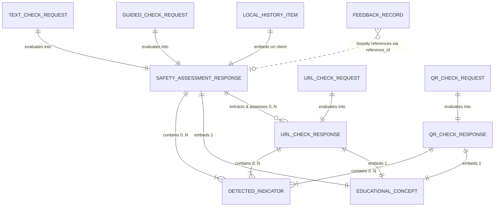

# Data Relationships

**Document Status:** Current as of V6.0 Release (October 2026)  
**Project:** Digital Payment Safety Assistant (ClearPay)  
**Classification:** Entity Relationships, Cardinality, Invariants, and Lifecycle Rules

---

## 1. Entity-Relationship Overview

In the Digital Payment Safety Assistant, data relationships exist across two distinct boundaries:
1. **In-Memory Analytical Domain (Backend):** Structured hierarchical relationships between Request DTOs, Safety Assessment Aggregators, Granular Threat Indicators, and Educational Concept Cards.
2. **Persistence & Client Domain (Frontend & Storage):** Relationships between Ephemeral Assessment Responses, User-Managed Local History records (`localStorage`), and Anonymous Feedback entries (`feedback_store.json`).

Because the system intentionally avoids a relational database engine (RDBMS) to prevent credential retention liabilities, referential integrity between the client, the backend, and the feedback store is maintained via **ephemeral token correlation** (`reference_id`), rather than database foreign key constraints.

---

## 2. Visual Entity-Relationship Diagram

---

## 3. Detailed Relationship Specifications

### 3.1 `SafetyAssessmentResponse` ↔ `DetectedIndicator`
- **Relationship Type:** One-to-Many Composition (Parent to Child).
- **Cardinality:** `1 : 0..*` (One assessment contains zero or more detected indicators).
- **Optionality:** A safe message has `0` indicators; a complex scam may contain `4` or more indicators (e.g. impersonation + urgency + credential demand + remote access tool).
- **Storage:** Embedded as a list in `indicators`.
- **Integrity Rule:** Indicators are immutable once computed by `detect_indicators_in_text()` and sorted by severity.

### 3.2 `SafetyAssessmentResponse` ↔ `EducationalConcept`
- **Relationship Type:** One-to-One Composition.
- **Cardinality:** `1 : 1` (Exactly one educational concept per assessment).
- **Optionality:** Mandatory. Every assessment provides a preventative "Golden Rule" tailored to the highest-severity indicator present (or general verification advice if low risk).
- **Storage:** Embedded as an object in `educational_concept`.

### 3.3 `SafetyAssessmentResponse` ↔ `URL_CHECK_RESPONSE` (`url_assessments`)
- **Relationship Type:** One-to-Many Association.
- **Cardinality:** `1 : 0..*` (One text message can contain zero or multiple URLs).
- **Implementation:** 
  - `backend/safety/detector.py:extract_urls_from_text()` extracts and sanitizes all URLs from message text.
  - `backend/safety/engine.py` calls `URLChecker.analyze_url()` on each extracted URL.
  - The resulting URL assessment objects are serialized and appended to `url_assessments`.
- **Integrity Rule:** If an embedded URL is flagged as `HIGH` risk, the parent `SafetyAssessmentResponse` elevates its own `risk_level` to `HIGH`.

### 3.4 `LocalHistoryItem` ↔ Assessment Response
- **Relationship Type:** One-to-One Client-Side Embedding.
- **Cardinality:** `1 : 1` (One local history entry wraps exactly one completed assessment).
- **Storage:** Persisted inside browser `window.localStorage` under key `payment_safety_assistant_history_v2`.
- **Integrity Rule:** Stored strictly client-side. The user can export or delete entries at any time without server communication.

### 3.5 `FeedbackRecord` ↔ `SafetyAssessmentResponse` (`reference_id`)
- **Relationship Type:** Weak Token Correlation (Decoupled Reference).
- **Cardinality:** `0..* : 1` (A single assessment reference token may have zero or more feedback submissions).
- **Implementation:**
  - When the backend generates an assessment, it assigns a random token: `REF-TXT-XXXXXXXX`, `REF-URL-XXXXXXXX`, or `REF-QR-XXXXXXXX`.
  - If the user clicks "Was this helpful?" or submits an accuracy report, `FeedbackRequest.reference_id` transmits this token.
  - The record is saved in `backend/feedback_store.json`.
- **Privacy Boundary:** The server **does not maintain** a reverse pointer from `reference_id` back to the raw message content, guaranteeing that user feedback can never be combined to re-identify the original message text.

### 3.6 `QRCheckResponse` ↔ `DetectedIndicator` & `EducationalConcept`
- **Relationship Type:** One-to-Many and One-to-One Composition.
- **Cardinality:** `1 : 0..*` for indicators, `1 : 1` for educational concept.
- **Specific Invariant:** If `raw_payload` begins with `upi://pay` and the user context indicates "receiving money", the `qr_receive_trap` indicator is deterministically attached.

---

## 4. Cardinality & Optionality Summary Matrix

| Parent Entity | Child / Related Entity | Multiplicity | Foreign Key Constraint | Storage Medium |
|---|---|---|---|---|
| `SafetyAssessmentResponse` | `DetectedIndicator` | `1 to 0..N` | Embedded In-Memory | Transient JSON |
| `SafetyAssessmentResponse` | `EducationalConcept` | `1 to 1` | Embedded In-Memory | Transient JSON |
| `SafetyAssessmentResponse` | Extracted `URLCheckResponse` | `1 to 0..N` | Embedded List (`url_assessments`) | Transient JSON |
| `URLCheckResponse` | `DetectedIndicator` | `1 to 0..N` | Embedded In-Memory | Transient JSON |
| `URLCheckResponse` | `EducationalConcept` | `1 to 1` | Embedded In-Memory | Transient JSON |
| `QRCheckResponse` | `DetectedIndicator` | `1 to 0..N` | Embedded In-Memory | Transient JSON |
| `QRCheckResponse` | `EducationalConcept` | `1 to 1` | Embedded In-Memory | Transient JSON |
| `LocalHistoryItem` | Assessment Object | `1 to 1` | Embedded in Record | Client `localStorage` |
| `FeedbackRecord` | Assessment Reference ID | `0..N to 1` | Weak String Reference (`reference_id`) | Server `feedback_store.json` |

---

## 5. Referential Integrity & Cascading Rules

Because ClearPay operates without an RDBMS:

1. **No Cascading Deletions Across Server:**
   - Clearing client history in `localStorage` has zero impact on `backend/feedback_store.json`.
   - Truncating `feedback_store.json` on the server has zero impact on client-side analysis histories.
2. **Client-Side History Eviction Rule:**
   - Client history maintains a strict FIFO capacity of `30` records.
   - When record `31` is created, `newRecord` is prepended and `slice(0, 30)` permanently drops the oldest item.
3. **Feedback Store Eviction Rule:**
   - Server feedback storage maintains a strict FIFO capacity of `500` records.
   - When record `501` is appended, `records = records[-500:]` permanently truncates the oldest feedback entry.
4. **Reference ID Life Expectancy:**
   - Assessment reference IDs (`REF-TXT-...`) are stateless tokens. They are valid for the client session and do not require server validation against a database lookup table.
