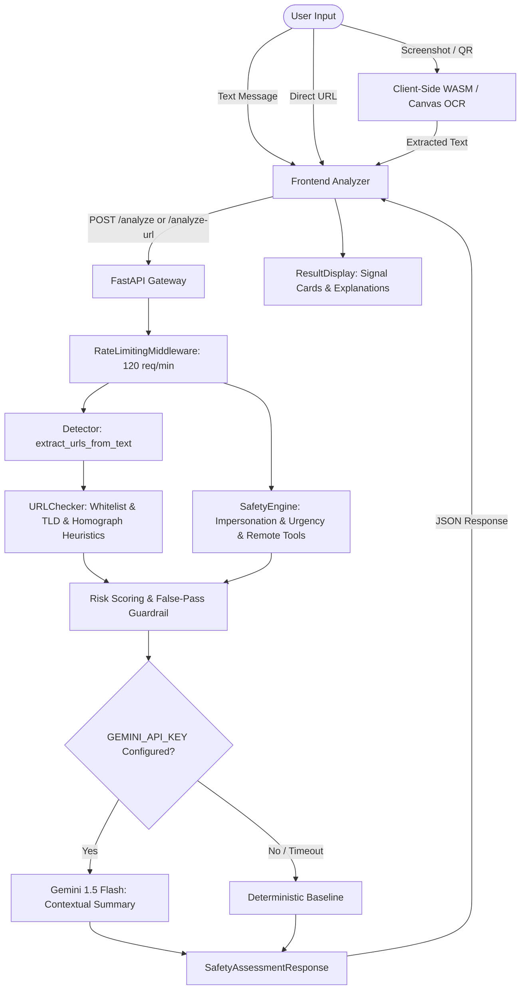

# Architectural Decisions

**Document Status:** Current as of V6.0 Release (October 2026)  
**Project:** Digital Payment Safety Assistant (ClearPay)  
**Classification:** System Architecture, Invariants, Trade-Offs, and Verification

---

## 1. Architectural Pattern: Stateless Modular Monolith / Dual-Client Utility

- **Decision:** The project is architected as an ephemeral, strictly stateless client-server security utility comprising a lightweight React single-page frontend, an offline-first Chrome Manifest V3 browser extension client, and a deterministic FastAPI backend rule engine.
- **Classification:** **CONFIRMED**
- **Evidence:** 
  - `backend/main.py`: Stateless FastAPI REST endpoints without session middleware or database sessions.
  - `backend/safety/engine.py`: Functional analysis pipeline returning structured Pydantic models.
  - `frontend/src/App.jsx`: State-driven single-page navigation (`landing` vs. `analyzer`).
  - `extension/manifest.json`: Manifest V3 extension communicating over REST to the backend.
- **Why Chosen:** A stateless utility maximizes user trust, eliminates database maintenance and data breach liabilities, achieves sub-millisecond local rule evaluation, and ensures resilience during peak scam waves without horizontal database scaling bottlenecks.

---

## 2. Frontend / Backend Separation

- **Decision:** Decoupled single-page application (SPA) and REST API architecture.
- **Classification:** **CONFIRMED**
- **Evidence:**
  - `frontend/vite.config.js`: Proxies `/api` requests to backend at `http://localhost:8000`.
  - `backend/main.py`: Configures `CORSMiddleware` with explicit origins (`http://localhost:5173`, `http://127.0.0.1:5173`, `chrome-extension://*`).
  - `frontend/src/services/apiClient.js`: Centralized HTTP client using standard `fetch` with AbortController timeouts (8000ms).
- **Trade-offs:**
  - *Advantage:* Allows multiple independent clients (web browser, browser extension, future mobile app) to share the exact same risk assessment engine without duplicating rule logic.
  - *Disadvantage:* Requires two local development runtimes (`vite` on port 5173, `uvicorn` on port 8000) rather than a single monolith bundle.

---

## 3. Major Modules and Responsibilities

| Module | Location | Responsibility | Status |
|---|---|---|---|
| **API Entrypoint & Routing** | `backend/main.py` | Exposes REST endpoints (`/analyze`, `/analyze-url`, `/api/check/*`, `/health`), CORS, rate limiting, and security headers | **CONFIRMED** |
| **Safety Engine Orchestrator** | `backend/safety/engine.py` | Coordinates text detection, URL extraction, payment rule evaluation, and final risk aggregation | **CONFIRMED** |
| **Heuristic & Pattern Engine** | `backend/safety/detector.py`, `scam_patterns.py` | Regex patterns, urgency cues, impersonation detection, remote-tool mentions, and URL extraction | **CONFIRMED** |
| **URL Safety Engine** | `backend/safety/url_checker.py` | Strict false-pass elimination, domain whitelist matching, homograph/punycode checks, TLD risk analysis | **CONFIRMED** |
| **QR Code Safety Service** | `backend/safety/qr_service.py` | Parses UPI payment URIs (`upi://pay`), validates payee VPA, flags reverse-charge collect scams | **CONFIRMED** |
| **AI Augmentation Service** | `backend/safety/ai_analysis.py` | Optional secondary reasoning via Google Gemini API; strictly preserves deterministic baseline on failure/absence | **CONFIRMED** |
| **Localization Engine** | `backend/safety/languages.py` | Localizes safety recommendations and educational concepts into Hindi and Hinglish | **CONFIRMED** |
| **Feedback Subsystem** | `backend/safety/feedback_service.py` | Bounded, privacy-safe JSON storage (`feedback_store.json`, max 500 items) for user accuracy ratings | **CONFIRMED** |
| **Schema & Contracts** | `backend/schemas/safety.py` | Pydantic V2 data contracts, risk enums, verification status codes | **CONFIRMED** |
| **Client Workspace UI** | `frontend/src/components/SafetyAnalyzer.jsx` | Two-column analysis workspace, link/message switcher, red-flag indicators, accessibility | **CONFIRMED** |
| **Marketing & Education Landing** | `frontend/src/components/landing/LandingPage.jsx` | Trust anchors, hero demo card, scam education, privacy guarantees | **CONFIRMED** |
| **On-Device Vision (OCR/QR)** | `ImageOCRCheck.jsx`, `UrlQrCheck.jsx` | Client-side text and QR extraction via Tesseract.js WASM and jsQR canvas parser | **CONFIRMED** |

---

## 4. Data Flow

- **Invariant:** At no point in the primary analysis flow is user data written to a database or sent to third-party advertising trackers.
- **Classification:** **CONFIRMED**

---

## 5. API Communication

- **Decision:** RESTful JSON over HTTP/HTTPS with explicit backward-compatibility aliases.
- **Classification:** **CONFIRMED**
- **Evidence:**
  - `backend/main.py`: Supports both legacy V1-V3 routes (`/api/check/text`, `/api/check/url`, `/api/check/qr`, `/api/check/guided`) and modern V6 routes (`/analyze`, `/api/analyze`, `/analyze-url`, `/api/analyze-url`).
  - Response schemas in `backend/schemas/safety.py` support aliased fields (`reasons` ↔ `indicators`, `recommendation` ↔ `educational_concept.golden_rule`).
- **Trade-offs:**
  - *Advantage:* Zero breakage across diverse API clients, older extension builds, and current frontend web releases.

---

## 6. Authentication & Authorization Architecture

- **Decision:** **Zero Authentication / Public Frictionless Access.**
- **Classification:** **CONFIRMED**
- **Evidence:** No JWT, OAuth, session cookies, database user tables, or auth middleware exist in `backend/` or `frontend/`.
- **Why Chosen:** 
  - ClearPay is an emergency triage utility used when individuals are actively experiencing panic or urgency (e.g., suspicious SMS demanding immediate payment to prevent power cutoff).
  - Requiring account registration, email verification, or login credentials introduces catastrophic user friction and creates unnecessary credential storage liabilities.

---

## 7. Database Architecture

- **Decision:** **No Database for Message Analysis (Fully Stateless Engine).**
- **Classification:** **CONFIRMED**
- **Evidence:**
  - `backend/requirements.txt` contains zero ORM or database packages (no SQLAlchemy, Alembic, psycopg, pymongo, or sqlite3 references).
  - Explicit privacy guarantee in UI: *"We never store your messages, passwords, or account details on our servers."*
  - The only server-side persistence is `backend/feedback_store.json`, a rolling, retention-bounded JSON file (max 500 entries) storing only anonymous ratings (`helpful`, `unclear`, `appears_incorrect`) and random reference IDs, with raw messages strictly stripped.
  - Client-side history is stored ephemerally in browser `window.localStorage` (capped at 10 items, entirely under user control).
- **Trade-offs:**
  - *Advantage:* Absolute privacy guarantee by design; zero risk of data leaks involving user-pasted financial credentials, OTPs, or phone numbers.
  - *Disadvantage:* Analysis history does not sync across devices or browsers.

---

## 8. External Services & Third-Party Integrations

- **Decision:** **Self-Contained Local Heuristics with Graceful Degradation.**
- **Classification:** **CONFIRMED**
- **Evidence:**
  - `backend/safety/url_checker.py`: External reputation feeds (Google Web Risk, Safe Browsing, URLhaus) are architected behind pluggable interfaces, but currently stubbed with graceful fallback: `checks_unavailable: ["external_reputation_provider_not_configured"]`.
  - `backend/safety/ai_analysis.py`: Google Gemini API (`gemini-1.5-flash`) is accessed via `httpx.AsyncClient` with a strict 4.0s timeout; if unavailable or missing `GEMINI_API_KEY`, it falls back silently to the deterministic baseline without error.
  - System operates with 100% test pass rate completely offline.

---

## 9. Deployment & Infrastructure Architecture

- **Decision:** Dual-service containerizable runtime.
  - Frontend: Compiles to pure static assets via `vite build` (deployable to Cloudflare Pages, Vercel, S3, or Nginx).
  - Backend: Standard ASGI application served by `uvicorn` (deployable to Google Cloud Run, AWS ECS, or Docker).
- **Classification:** **INFERRED** from standard Vite build and FastAPI entrypoint.
- **Evidence:** `run_all.bat`, `run_backend.bat`, `run_frontend.bat` automate local execution.

---

## 10. Summary of Architectural Invariants

1. **False-Pass Elimination:** *"No match is not proof of safety. Unknown results must stay unknown."* (Enforced in `url_checker.py`).
2. **On-Device Vision:** Screenshots and QR codes are decoded via WebAssembly / Canvas in the client browser, never uploaded as raw image files to backend servers.
3. **Passive URL Analysis:** The backend never sends live outbound HTTP requests or crawls analyzed target links (prevents drive-by exploits and token validation).
4. **Deterministic Sovereignty:** Deterministic rule engine results are authoritative; AI enhancement is purely explanatory and can never override or relax detected high-risk indicators.
